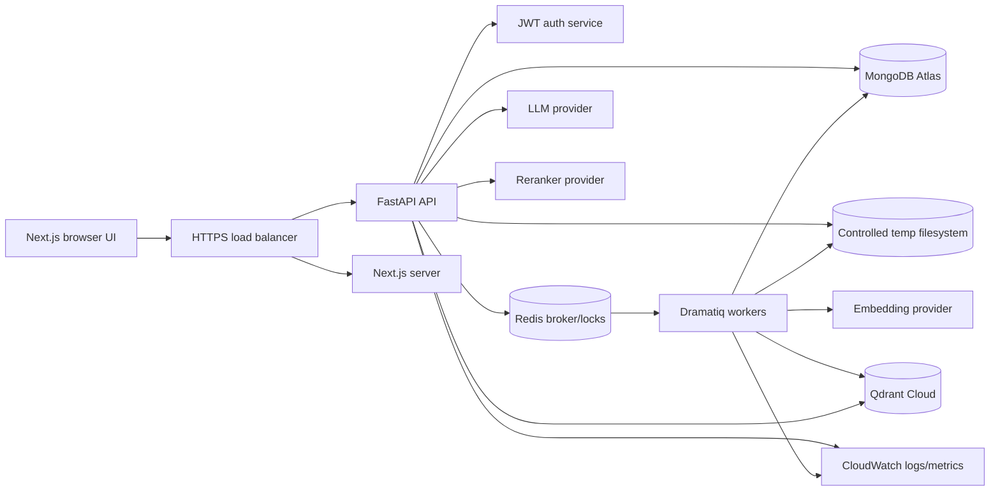
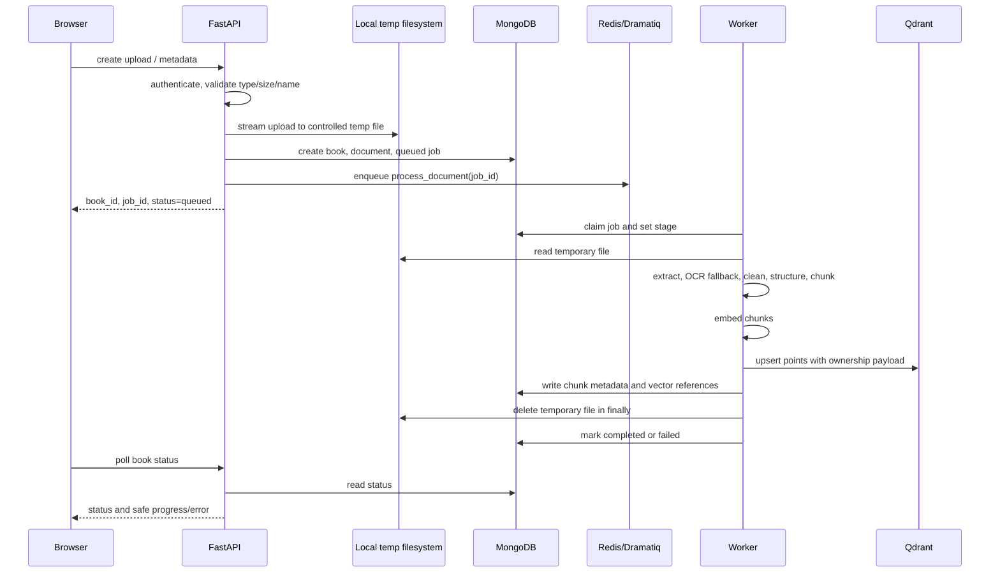
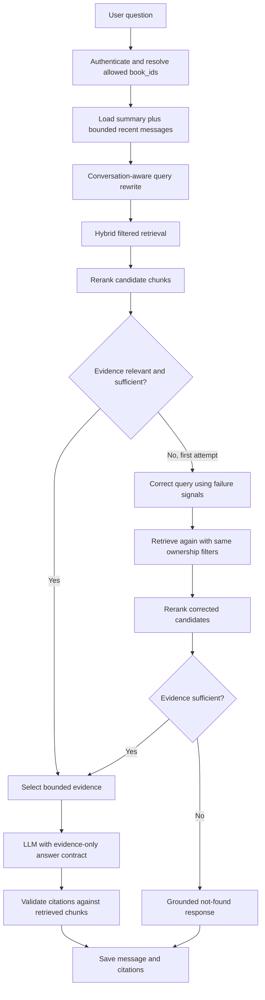

# Chat With Your Book: Architecture Proposal

Status: **Implemented MVP design; local-only document storage enforced**

This document defines the production-oriented MVP boundary. It favors grounded answers and traceable citations over broad agent behavior or maximum retrieval sophistication.

## 1. Requirements and acceptance criteria

### Product capabilities

- Authenticated users can register, log in, log out, and manage their own books.
- A user can upload multiple PDF and DOCX documents.
- Uploads return quickly and processing is asynchronous.
- A book exposes processing status and failure details without exposing internal stack traces.
- A user can chat with one book or a selected set of the user's books.
- Follow-up questions use a bounded conversation summary and recent-message window.
- Answers cite only retrieved chunks that were actually used.
- If retrieval remains insufficient after correction, the assistant states that the answer was not found in the uploaded book.
- Users cannot read or mutate another user's books, jobs, conversations, messages, chunks, vectors, or objects.

### Hard invariants

1. `user_id` always comes from the verified access token, never from request JSON, query parameters, or upload metadata.
2. Original files exist only in the backend's controlled temporary filesystem during processing. MongoDB stores metadata and processed chunk text, never complete PDF/DOCX binaries.
3. Qdrant stores embeddings and searchable vector payloads. MongoDB stores chunk text and traceability metadata, but not duplicate embedding arrays.
4. Every retrieval filter includes the authenticated `user_id`; book filters are additive, never a substitute for user isolation.
5. Retrieved document text is delimited as data and cannot change system, developer, or application instructions.
6. A citation is emitted only from a retrieved chunk with a valid MongoDB record and matching ownership checks.
7. Upload handling, extraction, OCR, chunking, embedding, and indexing happen in workers.

## 2. Technology decisions

### Frontend

- **Next.js App Router, React, TypeScript, Tailwind CSS**.
- Server components are used for authenticated shells and metadata-heavy pages; client components handle upload progress, chat streaming, and interactive status.
- The browser never receives provider credentials. Chat streaming uses an authenticated application endpoint.

### Backend

- **FastAPI, Pydantic v2, Motor** for async HTTP, validation, and MongoDB access.
- Python package boundaries separate API handlers, domain services, providers, repositories, and workers.
- OpenAPI is generated by FastAPI and treated as the source of truth for the frontend client.

### Primary database: MongoDB

MongoDB is the system of record for identity, ownership, document metadata, chunk text/metadata, job state, conversations, messages, and citations. It supports the required document-shaped data and atomic status transitions without introducing a relational database.

### Vector database: Qdrant

**Choice: Qdrant Cloud for production; Qdrant in Docker for local development.**

Why it fits this MVP:

- First-class payload filters make `user_id`, `book_id`, and `document_id` isolation explicit.
- Collection and point APIs are simple to operate from Python.
- Good support for dense vectors and hybrid sparse+dense retrieval without making MongoDB carry embedding workloads.
- Self-hosted local parity is straightforward; Qdrant Cloud avoids operating a second search cluster in production.
- Payloads can carry the required traceability fields while MongoDB remains authoritative for full text and citations.

Alternatives considered:

- **Pinecone:** managed and capable, but higher vendor coupling and less convenient local parity.
- **Weaviate:** strong feature set, but adds schema/module complexity for this MVP.
- **OpenSearch:** useful when BM25 and operational search are central, but heavier to operate and unnecessary when Qdrant supports dense plus sparse retrieval.
- **MongoDB Vector Search:** reduces services, but would make MongoDB own both system-of-record and vector-search scale. The dedicated-vector requirement and independent scaling favor Qdrant.

Qdrant collection design:

- One collection: `VECTOR_DB_COLLECTION`.
- Point ID: `chunk_id` (UUID string).
- Dense vector: configured embedding dimension from `EMBEDDING_MODEL`.
- Optional sparse vector: BM25/SPLADE-compatible representation for hybrid retrieval; enabled only if the selected Qdrant client/provider supports it in the initial implementation.
- Payload: `user_id`, `book_id`, `document_id`, `chunk_id`, `page_number`, `chapter`, `section`, `chunk_index`, and a normalized text-search field.
- MongoDB is queried after retrieval to hydrate authoritative chunk text and verify ownership.

### Background jobs: Dramatiq

**Choice: Dramatiq with Redis as the broker/result-free coordination backend.**

Why:

- Small API with clear actor semantics and retries.
- Python-native and easy to run locally beside FastAPI.
- Pipeline stages can be idempotent and independently retried.
- Redis is already useful for short-lived locks, rate limits, and job coordination.

Alternatives considered:

- **Celery:** mature and broad, but more configuration and operational surface than the MVP needs.
- **RQ:** simple, but fewer built-in controls for complex retry/actor workflows.
- **SQS + workers:** strong AWS durability, but introduces AWS-specific queue behavior and local-development friction; consider later if queue durability or regional scale requires it.

### Document storage: local temporary filesystem

- The browser streams each upload directly to FastAPI.
- FastAPI writes it to `TEMP_UPLOAD_DIR` using a generated filename, never a user-controlled path.
- MongoDB stores only file metadata and the short-lived local processing path in `processing_jobs`.
- The Dramatiq worker reads the temporary file and deletes it in a `finally` block after success or failure.
- No S3, R2, cloud object store, or long-term original-file storage is used.

### AWS services

Use only the following in production, and only where they solve a concrete operational need:

- **ECS/Fargate:** run the stateless Next.js service, FastAPI service, and Dramatiq workers without managing servers.
- **Application Load Balancer:** terminate HTTPS and route `/api` to FastAPI and web traffic to Next.js if deployed separately.
- **Secrets Manager:** inject MongoDB, Qdrant, LLM, embedding, and auth secrets at task startup.
- **CloudWatch:** centralized logs, metrics, alarms, and worker failure visibility.

MongoDB Atlas, Qdrant Cloud, and the model providers remain managed external services. No EC2, Lambda, RDS, or object-storage service is required for the MVP.

## 3. Architecture diagrams

### Component architecture



### Ingestion data flow



### Chat and CRAG flow



## 4. MongoDB schema

All IDs are application-generated UUID strings (or another single documented ID type), stored consistently. All timestamps are UTC BSON dates. Every repository query applies ownership constraints before ID constraints.

### `users`

```text
_id: ObjectId
user_id: string, unique
email: string, normalized, unique
password_hash: string
is_active: boolean
created_at: date
updated_at: date
last_login_at: date | null
```

Indexes: `{ email: 1 }` unique; `{ user_id: 1 }` unique.

### `books`

```text
_id: ObjectId
book_id: string, unique
user_id: string
title: string
author: string | null
file_name: string
file_type: "pdf" | "docx"
file_size: int64
mime_type: string
checksum_sha256: string
upload_date: date
processing_status: "queued" | "uploading" | "extracting" | "cleaning" | "chunking" | "embedding" | "indexing" | "completed" | "failed"
processing_error: string | null
page_count: int | null
chunk_count: int
created_at: date
updated_at: date
```

Indexes: `{ user_id: 1, created_at: -1 }`; `{ book_id: 1, user_id: 1 }` unique; `{ user_id: 1, processing_status: 1 }`.

### `documents`

```text
document_id: string, unique
book_id: string
user_id: string
file_name: string
file_type: "pdf" | "docx"
mime_type: string
file_size: int64
page_count: int | null
processing_status: same status enum as books
created_at: date
updated_at: date
```

Indexes: `{ book_id: 1, user_id: 1 }`; `{ document_id: 1, user_id: 1 }` unique; `{ user_id: 1 }`.

### `document_chunks`

```text
chunk_id: string, unique
book_id: string
document_id: string
user_id: string
chunk_text: string
page_number: int | null
chapter: string | null
section: string | null
paragraph: int | null
chunk_index: int
metadata: object
vector_reference: { provider: "qdrant", collection: string, point_id: string }
created_at: date
```

`metadata` contains extraction and tokenizer details, not secrets. Indexes: `{ user_id: 1, book_id: 1, document_id: 1, chunk_index: 1 }`; `{ book_id: 1, document_id: 1, page_number: 1 }`; `{ chunk_id: 1, user_id: 1 }` unique.

### `conversations`

```text
conversation_id: string, unique
user_id: string
book_id: string | null
book_ids: string[]
title: string
summary: string | null
summary_updated_at: date | null
created_at: date
updated_at: date
```

Exactly one of `book_id` or a non-empty `book_ids` is used by the application contract. Indexes: `{ user_id: 1, updated_at: -1 }`; `{ user_id: 1, book_id: 1 }`; `{ user_id: 1, book_ids: 1 }`.

### `messages`

```text
message_id: string, unique
conversation_id: string
user_id: string
role: "user" | "assistant" | "system_event"
content: string
sources: [{ citation_id: string, chunk_id: string }]
retrieval_metadata: { attempt_count: int, query: string, sufficient: boolean } | null
created_at: date
```

Indexes: `{ conversation_id: 1, created_at: 1 }`; `{ message_id: 1, user_id: 1 }` unique; `{ user_id: 1, created_at: -1 }`.

### `citations`

```text
citation_id: string, unique
message_id: string
user_id: string
book_id: string
document_id: string
chunk_id: string
page_number: int | null
chapter: string | null
section: string | null
source_text: string
created_at: date
```

The citation stores the exact bounded excerpt used for the answer, not an invented page marker. Indexes: `{ message_id: 1, user_id: 1 }`; `{ chunk_id: 1, user_id: 1 }`; `{ book_id: 1, user_id: 1 }`.

### `processing_jobs`

```text
job_id: string, unique
user_id: string
book_id: string
document_id: string
status: "queued" | "uploading" | "extracting" | "cleaning" | "chunking" | "embedding" | "indexing" | "completed" | "failed"
current_stage: string
progress: int, 0..100
error: string | null
attempt: int
started_at: date | null
completed_at: date | null
created_at: date
updated_at: date
```

Indexes: `{ book_id: 1, user_id: 1, status: 1 }`; `{ user_id: 1, status: 1, created_at: -1 }`; `{ job_id: 1, user_id: 1 }` unique.

## 5. Processing and retrieval design

### Upload and ingestion

1. Authenticate the request and normalize/sanitize the original filename to a safe basename. The filename is display metadata, never a storage path.
2. Validate extension, declared MIME, detected file signature, maximum size, and tenant quota. Reject archives, executables, macros, and unsupported formats.
3. Create IDs server-side. Stream the original to a generated path under `TEMP_UPLOAD_DIR` and record size/type metadata.
4. Create book, document, and queued job records including the short-lived temp path. Enqueue only IDs, never large document content.
5. Worker claims the job with an ownership-aware atomic transition. Each stage is idempotent and updates progress.
6. Extract PDF/DOCX text with page boundaries where available. Scanned PDFs go through a bounded OCR fallback. OCR is disabled for unsupported or oversized inputs until explicitly enabled by policy.
7. Normalize whitespace and Unicode, preserve page/heading boundaries, detect chapters and sections, and chunk by headings/paragraphs with configurable `CHUNK_SIZE` and `CHUNK_OVERLAP`.
8. Embed chunks through `EmbeddingProvider`. Upsert Qdrant points with all required ownership and traceability payload.
9. Store chunk metadata and Qdrant point references in MongoDB. Delete the temp file in `finally`, then mark the job and book completed only after both stores are consistent; failed writes are retried and reconciled.

### Provider interfaces

```text
LLMProvider.generate/generate_stream
EmbeddingProvider.embed_documents/embed_query
RerankerProvider.rerank
VectorStoreProvider.upsert/delete/search
```

Providers receive typed domain inputs and return typed results. API and domain code never imports vendor SDK types directly.

### CRAG behavior

- Rewrite a follow-up into a standalone search query using only the bounded conversation context.
- Retrieve dense and keyword/sparse candidates with a mandatory Qdrant payload filter: `user_id == authenticated_user_id` plus selected `book_ids`.
- Rerank candidates. A relevance grader checks direct support, completeness, and source consistency using a structured provider response.
- If the first set is poor, perform one corrective rewrite that uses the question and retrieval failure signals, then retrieve and rerank once more.
- The MVP has a maximum of two retrieval attempts and a bounded evidence token budget. This prevents runaway cost and latency.
- Generate with an evidence-only system contract: answer only from supplied excerpts, distinguish absence from uncertainty, and attach source IDs only from the supplied candidate set.
- Validate every generated citation against the retrieved chunk IDs, ownership, and stored metadata. Drop invalid citations and downgrade the response to a not-found answer when the answer is not supportable.

Not-found response contract: `I couldn't find that in the uploaded book(s).` Optional wording may explain that the retrieved passages did not provide sufficient evidence; it must not answer from general knowledge.

## 6. REST API design

All routes are under `/api`, return JSON except the streaming chat body, and require `Authorization: Bearer <access_token>` unless marked public. FastAPI publishes the complete OpenAPI schema at `/docs` in development and behind authenticated/admin access in production.

### Auth

- `POST /api/auth/register`
  - Body: `{ email, password }`
  - Response `201`: `{ user_id, email, access_token, token_type: "bearer" }`
  - Public. Passwords use Argon2id. Do not reveal whether an email already exists beyond the chosen product policy.
- `POST /api/auth/login`
  - Body: `{ email, password }`
  - Response `200`: same token envelope.
- `POST /api/auth/logout`
  - Revokes the refresh/session token if sessions are used. Short-lived access tokens remain self-contained and expire naturally; a server-side denylist is optional for emergency revocation.

### Books and uploads

- `POST /api/books/upload`
  - Multipart fields: `file`, optional `title`, optional `author`.
  - Validates and streams the file to the controlled backend temp directory, creates records, and enqueues processing.
  - Response `202`: `{ book_id, document_id, job_id, processing_status }`.
  - Never waits for extraction or embeddings.
- `GET /api/books`
  - Query: `status`, `cursor`, `limit`.
  - Returns only the authenticated user's books with safe processing fields.
- `GET /api/books/{book_id}`
  - Returns book metadata and current processing status after ownership check.
- `GET /api/books/{book_id}/status`
  - Returns `{ book_id, status, current_stage, progress, error }`; errors are sanitized.
- `DELETE /api/books/{book_id}`
  - Ownership check, delete MongoDB records, enqueue asynchronous cleanup of Qdrant points, and remove any remaining temp file. Return `202` with cleanup status rather than blocking.

### Chat and conversations

- `POST /api/chat`
  - Body: `{ conversation_id?: string, book_id?: string, book_ids?: string[], message: string, stream?: boolean }`.
  - Exactly one book scope is required for a new conversation; all selected books must belong to the caller and be completed.
  - Non-stream response `200`: `{ conversation_id, message_id, content, citations[], retrieval: { attempts, sufficient } }`.
  - Stream response: authenticated event stream with `token`, `citation`, `metadata`, and `done` events. Persist the final assistant message and citations after successful generation.
- `GET /api/conversations`
  - Query: `book_id`, `cursor`, `limit`.
  - Returns the caller's conversation summaries only.
- `GET /api/conversations/{conversation_id}`
  - Returns bounded message history and citations after ownership check.
- `DELETE /api/conversations/{conversation_id}`
  - Deletes or soft-deletes the caller's conversation and its messages/citations asynchronously if needed.

Error envelope:

```json
{
  "error": {
    "code": "BOOK_NOT_FOUND",
    "message": "The requested book was not found.",
    "request_id": "opaque-request-id"
  }
}
```

Clients never receive stack traces, provider responses, credentials, raw database errors, or server filesystem paths.

## 7. Proposed folder structure

```text
.
├── README.md
├── docs/
│   └── ARCHITECTURE.md
├── frontend/
│   ├── app/
│   │   ├── (auth)/login/page.tsx
│   │   ├── (auth)/register/page.tsx
│   │   ├── (app)/books/page.tsx
│   │   ├── (app)/books/[bookId]/page.tsx
│   │   ├── (app)/chat/[conversationId]/page.tsx
│   │   ├── layout.tsx
│   │   └── api/                    # only when a Next.js edge/BFF route is justified
│   ├── components/
│   ├── lib/
│   │   ├── api-client.ts
│   │   ├── auth.ts
│   │   └── types.ts
│   ├── public/
│   ├── package.json
│   └── tailwind.config.ts
├── backend/
│   ├── app/
│   │   ├── main.py
│   │   ├── config.py
│   │   ├── api/routes/
│   │   ├── auth/
│   │   ├── domain/
│   │   ├── models/
│   │   ├── repositories/
│   │   ├── services/
│   │   │   ├── ingestion/
│   │   │   ├── rag/
│   │   │   └── chat/
│   │   ├── providers/
│   │   │   ├── object_storage.py
│   │   │   ├── llm.py
│   │   │   ├── embeddings.py
│   │   │   ├── reranker.py
│   │   │   └── vector_store.py
│   │   ├── workers/
│   │   └── db/
│   ├── tests/
│   │   ├── unit/
│   │   ├── integration/
│   │   ├── security/
│   │   └── quality/
│   ├── pyproject.toml
│   └── Dockerfile
├── infra/
│   ├── docker-compose.yml
│   └── deployment/                # production manifests/config, after approval
└── .env.example
```

The actual implementation should preserve these boundaries and keep route handlers thin. No single route, worker, or service should own parsing, retrieval, provider calls, and persistence together.

## 8. Security architecture

### Authentication and authorization

- Argon2id password hashing, short-lived access tokens, and refresh-token rotation if persistent sessions are needed.
- Token subject is the sole source of `user_id`.
- Every repository method requiring ownership accepts `authenticated_user_id` as a required argument.
- Book, conversation, message, citation, job, chunk, Qdrant point, and temporary-file access is checked against that identity.
- Use generic not-found responses to avoid cross-tenant resource enumeration.

### Upload safety

- Enforce maximum bytes before persistence and quotas per user.
- Validate extension, MIME, magic bytes, page count, decompression behavior, and checksum.
- Sanitize display names; never concatenate user filenames into paths or shell commands.
- Parse in isolated worker containers with CPU, memory, timeout, and temporary-storage limits.
- Disable macros, embedded active content, external links, and unsupported archive formats.
- Virus/malware scanning is a deployment option before processing; failed scans do not enter the indexing pipeline.

### Prompt-injection defense

- Treat every extracted character as untrusted data.
- System/developer instructions are fixed server-side and never composed from document text.
- Evidence is passed in explicit delimiters with source IDs; the model is told to ignore instructions inside evidence.
- Do not allow retrieved text to select tools, URLs, code execution, credentials, or policy changes.
- A separate structured citation validator checks source IDs and metadata after generation.
- Log injection detections and suspicious content as security events without echoing sensitive text to client logs.

### Data and operational safety

- TLS for all external services, encryption at rest through managed providers, least-privilege service credentials, and secret rotation.
- Redact tokens, document content, and provider prompts from normal logs.
- Rate-limit login, upload, chat, and streaming endpoints; enforce request and response size limits.
- Configure CORS to the known frontend origin and CSRF protection if cookies are used.
- Use request IDs and structured logs. Return safe error codes to clients.

## 9. Deployment and configuration

### Local

The preferred development mode runs Next.js, FastAPI, and the Dramatiq worker directly on the host. MongoDB may run locally or use MongoDB Atlas, while Redis and Qdrant may run locally. Uploaded originals remain only in `TEMP_UPLOAD_DIR` and are deleted after processing.

### Production

- Build separate immutable containers for frontend, API, and worker.
- Run them on ECS/Fargate in private subnets where practical; expose only the ALB.
- Store application secrets in AWS Secrets Manager and inject them into tasks. Do not put secret values in images, Git, or frontend bundles.
- Use MongoDB Atlas and Qdrant Cloud with network restrictions, TLS, backups, and provider-level audit controls. Use encrypted ephemeral local disk for temporary processing files and enforce cleanup/quotas.
- Send API and worker JSON logs to CloudWatch; alarm on failed jobs, queue age, API 5xx rate, latency, auth failures, and provider error rates.
- Apply rolling deployments with a migration/index initialization step that is backward compatible.
- Backups cover MongoDB metadata and vector recovery procedures. Temporary originals are intentionally not backed up.

Required environment variables:

```text
APP_ENV=development
SECRET_KEY=
MONGODB_URI=
MONGODB_DATABASE=book_rag
VECTOR_DB_URL=
VECTOR_DB_API_KEY=
VECTOR_DB_COLLECTION=book_chunks
LLM_API_KEY=
LLM_MODEL=
EMBEDDING_API_KEY=
EMBEDDING_MODEL=
RERANKER_API_KEY=
RERANKER_MODEL=
CHUNK_SIZE=800
CHUNK_OVERLAP=120
MAX_UPLOAD_BYTES=52428800
TEMP_UPLOAD_DIR=.tmp/uploads
REDIS_URL=redis://redis:6379/0
```

All values are examples/placeholders. Production values come from the deployment secret store.

## 10. Verification plan by phase

1. **Architecture:** review this document, especially Qdrant/Dramatiq choices, upload limits, auth token strategy, and streaming contract.
2. **Backend foundation:** run type checks, unit tests for ownership filters, auth tests, upload validation tests, and API contract tests.
3. **Processing:** fixture tests for born-digital PDF, scanned PDF OCR, DOCX headings, page mapping, chunk boundaries, retries, and idempotency.
4. **RAG:** deterministic fake-provider tests for metadata filters, hybrid retrieval, reranking, and chunk-to-citation traceability.
5. **CRAG:** tests for relevant evidence, irrelevant evidence, corrected retrieval, missing information, and maximum attempt fallback.
6. **Chat:** tests for conversation ownership, bounded history, streaming persistence, disconnect handling, and citation validation.
7. **Frontend:** browser tests for auth, upload progress, processing states, chat streaming, citations, empty/error states, and responsive layouts.
8. **Security:** cross-user access, invalid/expired tokens, malicious filenames, MIME spoofing, oversized files, prompt injection, rate limits, and secret/log redaction.
9. **Deployment:** build all containers, run Compose smoke tests, verify health checks, then deploy to a non-production environment with alarms.

## 11. Review decisions requested

Before implementation, confirm:

- Qdrant is accepted as the dedicated vector database.
- Dramatiq + Redis is accepted for background jobs.
- JWT access tokens with optional rotating refresh tokens are acceptable.
- The MVP supports PDF/DOCX and one corrective retrieval retry.
- The initial chat endpoint may support both complete JSON and authenticated event streaming.
- Upload and model-provider quota limits can use the proposed defaults and be made configurable.
- Production deployment target is ECS/Fargate with MongoDB Atlas, Qdrant Cloud, Secrets Manager, and CloudWatch. ECS services must provide encrypted ephemeral task storage shared by the API and worker for the lifetime of each queued job, or co-locate upload processing with the worker.
